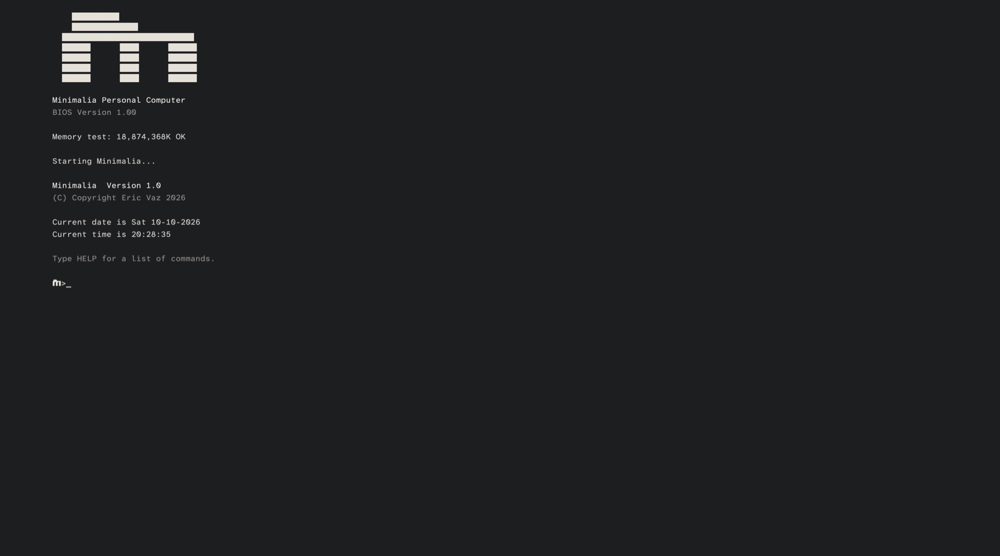
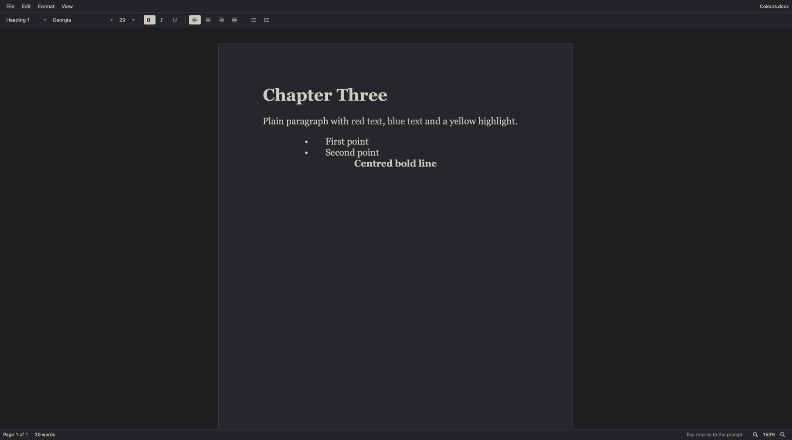
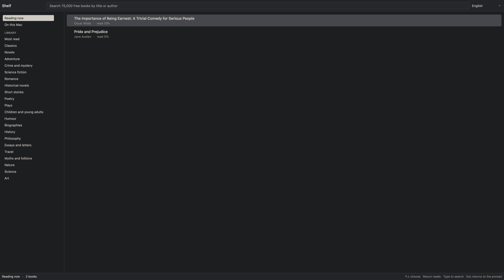
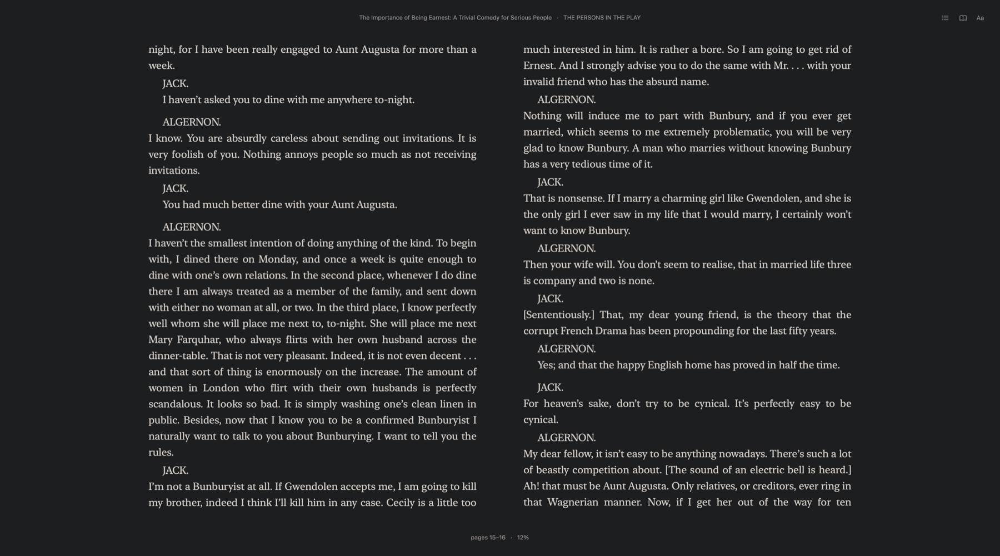
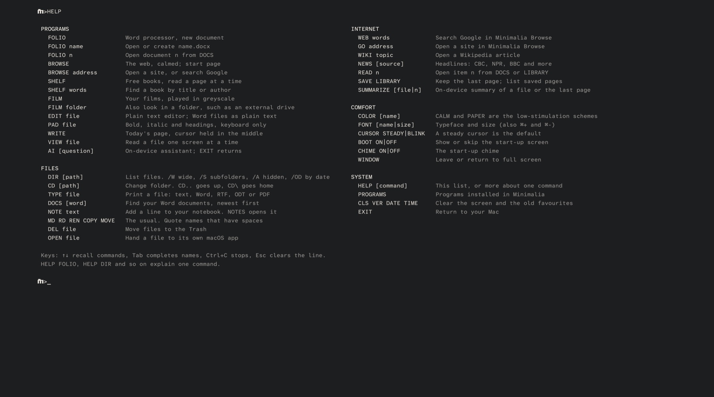

# Minimalia

Minimalia is a quiet computer for writing and reading. Open it on your Mac and the screen becomes a calm, full-screen prompt in the spirit of the machines of the 1980s, with the tools of today behind it: a page to write on, a word processor that opens Word documents, 75,000 free books, the web without the noise, your mail and your films. There are no notifications, no feeds and no windows to juggle, and a focus session keeps you there until the time is up.

I built it for anyone who wants to focus, including me.

## Programs

Everything opens inside Minimalia and returns to the prompt with Esc.

| Type | Program | What it does |
|---|---|---|
| `WRITE` | Write | One page a day, with the line you are writing held in the middle of the screen |
| `FOLIO` | Minimalia Folio | Word processor with menus and a toolbar. Opens and saves .docx, .doc, .odt, .rtf and .txt, prints and exports PDF |
| `BROWSE` | Minimalia Browse | The real web, shown in greyscale, with ads, trackers and cookie banners blocked and nothing playing by itself. Any page can be turned into plain text |
| `SHELF` | Minimalia Shelf | Project Gutenberg's free library, organised into shelves, read a page at a time like an e-reader |
| `LETTERS` | Minimalia Letters | Your mail, one letter at a time, as calm text. Gmail and most other accounts |
| `FILM` | Minimalia Film | The films on your Mac or an external drive, arranged like a quiet cinema and played in greyscale |
| `GAMES` | Minimalia Games | BLOCKS (falling blocks, made for Minimalia), your own DOS games in DOSBox Staging, Mega Drive, SNES, NES and Game Boy games in RetroArch, and classic Macintosh through Infinite Mac |
| `PAD` | Minimalia Pad | Formatted writing without leaving the prompt, keyboard only |
| `EDIT` | Minimalia Edit | Plain text editor |
| `AI` | Intelligence | Apple's on-device model. Nothing you type leaves the Mac |

## At the prompt

    HELP                    every command, in two columns
    HELP FOLIO              everything about one command or program
    DIR                     list the folder you are in
    CD Desktop              move into a folder (Tab completes names)
    DOCS                    every Word document you own, newest first
    FOLIO 3                 open document 3 from that list
    WEB 15-minute city      search Google
    NEWS CBC                today's headlines from a quiet news site
    SHELF neolithic         find free books on a subject
    FILM /Volumes/Films     also look for films on an external drive
    FOCUS 45                stay here for 45 minutes: no switching apps until the time is up
    NOTE call the press     add a line to your notebook
    SUMMARIZE               a short summary of the last page or a file
    COLOR PAPER             CALM, PAPER, GREEN, AMBER, WHITE or BLUE
    EXIT                    back to your Mac

## Focus sessions

`FOCUS 45` keeps you in Minimalia for 45 minutes. Switching apps with Command-Tab, hiding Minimalia, leaving full screen and quitting are held back until the time is up; `FOCUS END` finishes early after a deliberate second step, and Force Quit always works in an emergency. If you quit and reopen during a session, it carries on.

macOS does not let apps turn on Do Not Disturb, but a Shortcut can. `FOCUS SETUP` shows how to make two small shortcuts that Minimalia then runs at the start and end of every session.

## Letters and Gmail

Letters connects with IMAP and SMTP. For Gmail, create an app password in your Google account (2-Step Verification needs to be on) and paste it into Letters once; it is kept in the macOS Keychain. Copies of Minimalia built with a Google OAuth client ID (set MinimaliaGoogleClientID in Resources/Info.plist) also offer Sign in with Google.

## Games

`GAMES` lists everything you can play. BLOCKS is built in. Your own DOS games and console game files go in Documents/Minimalia/GAMES (Add Games copies them there); DOS games run in [DOSBox Staging](https://www.dosbox-staging.org) and console games in [RetroArch](https://www.retroarch.com), both installed separately, for example with `brew install --cask dosbox-staging-app retroarch-metal`. Games are not included: add only games you have the right to play. Games wait until a focus session ends.

## Calm by design

- The default CALM scheme is soft charcoal and warm grey rather than pure black and white. Text contrast is about 10:1, well above the 4.5:1 accessibility minimum. PAPER is its daylight twin.
- Programs use greys only. Coloured text in a document is shown in grey but saved with its real colours.
- Text is set in Atkinson Hyperlegible Mono, designed by the Braille Institute for legibility.
- The cursor is steady, nothing moves by itself, and every screen keeps the same layout.
- DEL and RD move files to the Trash. Nothing is erased for good.

## Requirements

- macOS 26 or later on Apple silicon.
- The assistant needs Apple Intelligence turned on in System Settings.
- Film plays .mp4, .m4v and .mov files.

## Building

    ./build.sh

This compiles Sources/ into Minimalia.app and WordApp/ into Minimalia Folio.app, a standalone version of the word processor. It needs Xcode. To stop macOS asking for folder access after every build, sign with a stable certificate: build.sh uses a "Developer ID Application" or "Minimalia Developer" certificate when one is in your keychain.

## Credits

Text is set in Atkinson Hyperlegible Mono by the Braille Institute, under the SIL Open Font License (Resources/Fonts/OFL.txt). Books come from Project Gutenberg. The start-up chime is not included in this repository; add your own as Resources/Chime.mp3.

## Licence

Minimalia is free software under the GNU General Public License, version 3. See LICENSE.

Copyright 2026 Eric Vaz.
